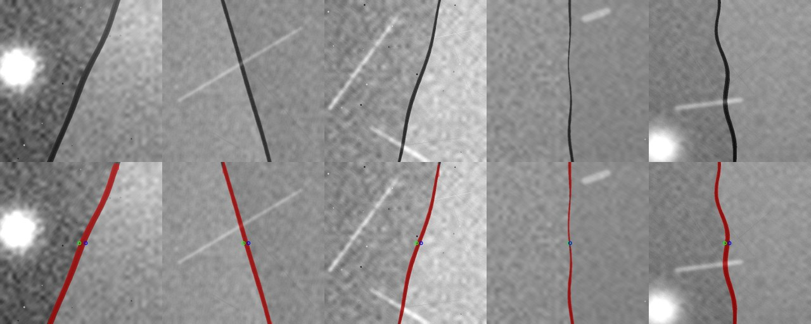
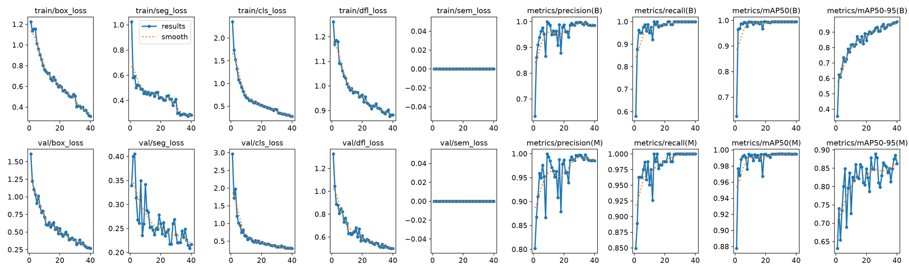
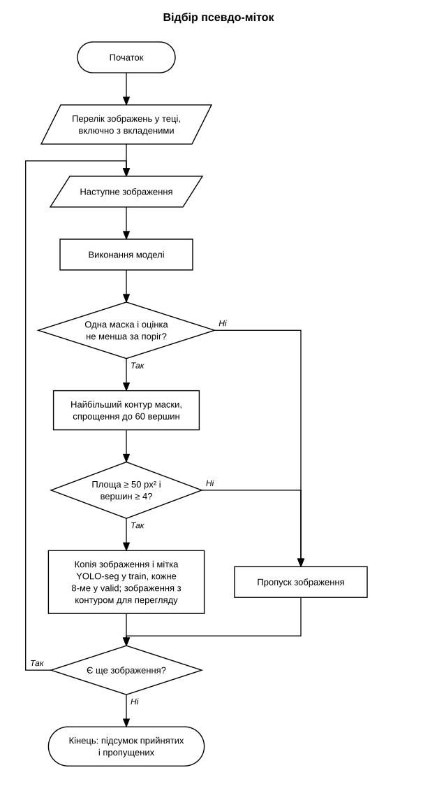
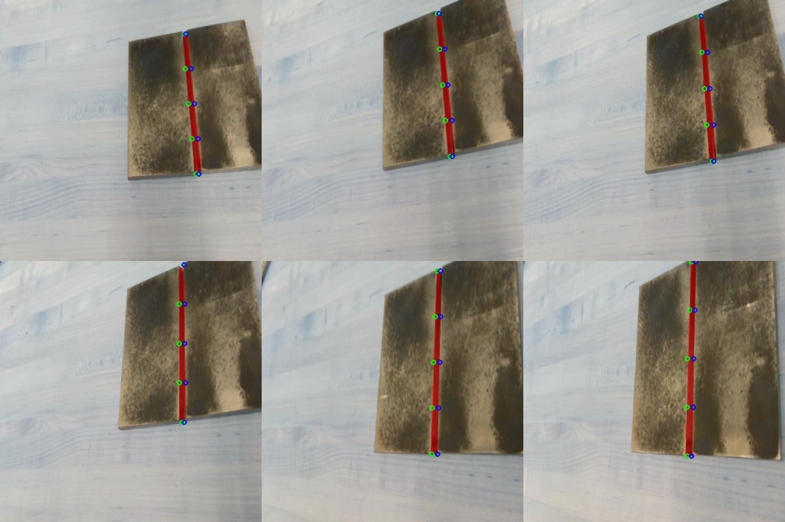
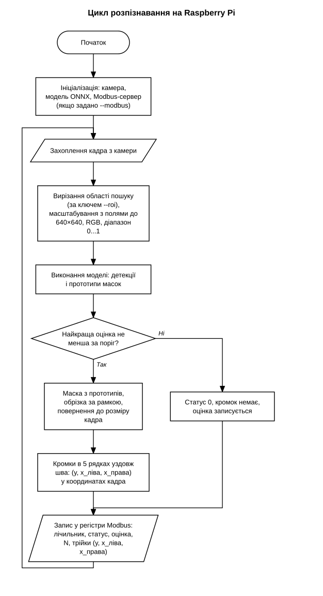

# Seam_Gap_Segmentation

Розпізнавання зазору в стику двох пластин на кадрі камери нейромережею сегментації YOLOv8-seg. За маскою зазору програма знаходить ліву й праву кромки у кількох рядках уздовж шва і публікує їхні координати в регістрах Modbus TCP сервера для контролера робота. Навчання виконується на ноутбуку з GPU, виконання розраховане на Raspberry Pi 5 з камерою IMX477.

Верхній ряд: синтетичні кадри з генератора. Нижній ряд: маска зазору, передбачена моделлю, і точки кромок на центральному рядку.



## Що реалізовано

- Генератор синтетичних кадрів зі стиком. Мітки створюються разом із кадром: полігон YOLO-seg, маска і точні координати кромок у кожному рядку.
- Навчання YOLOv8n-seg на синтетиці та реальних кадрах із відкритого набору.
- Самонавчання: модель розмічає нерозмічені реальні кадри, відбираються прогнози з високою впевненістю.
- Експорт у ONNX (opset 11) для компілятора Hailo.
- Код для Raspberry Pi: збір кадрів, виконання моделі без Ultralytics (onnxruntime, NumPy, OpenCV), Modbus TCP сервер із регістрами кромок.

## Схема

```
generate_seams.py  ->  train.py  ->  export_onnx.py  ->  best.onnx  ->  Raspberry Pi 5
  синтетика              YOLOv8n-seg      ONNX opset 11                  камера -> модель -> кромки -> Modbus TCP
        +
  реальні кадри Roboflow  ->  pseudolabel.py  ->  додаткові кадри для train.py
```

## Дані

| Набір | Кадрів (train / valid / test) | Зміст | Використання |
|---|---|---|---|
| Синтетика, генератор `generate_seams.py` | 432 / 68 / 0 | сірі кадри 640×640, зазор 4...26 px під кутом до ±25° | навчання і валідація |
| welding-jointb | 135 / 13 / 6 | стик двох пластин, вигляд зверху | навчання і валідація |
| seam-adoip | 104 / 15 / 8 | зазори між панелями автомобіля | лише псевдо-мітки |
| welding-seam-nwwjb | 77 / 22 / 11 | шви кутових і таврових з'єднань | лише псевдо-мітки |

Три реальні набори взято з Roboflow Universe, ліцензія CC BY 4.0:

- welding-jointb, автор `college-izka9`: https://universe.roboflow.com/college-izka9/welding-jointb/dataset/1
- seam-adoip, автор `timepass-btdez`: https://universe.roboflow.com/timepass-btdez/seam-adoip/dataset/1
- welding-seam-nwwjb, автор `internet-plus`: https://universe.roboflow.com/internet-plus/welding-seam-nwwjb/dataset/1

Бібліотека Ultralytics (YOLOv8) поширюється за ліцензією AGPL-3.0.

Набори в репозиторій не входять, крім шести кадрів на ілюстрації в розділі про код для Raspberry Pi. Для навчання їх завантажують у `datasets/` у форматі YOLOv8 Segmentation. Склад сумішей описано в `datasets/merged.yaml` і `datasets/merged_v2.yaml`.

## Генератор синтетики

Кадр складається з двох пластин із текстурою шліфованого металу (смуги, нерівномірна відбивність, подряпини) і темного зазору між ними. Центральна лінія зазору нахилена і має плавне відхилення, ширина змінюється вздовж шва, краї мають шорсткість. Поверх додаються ефекти, типові для зварювальної ділянки:

- нерівномірне освітлення: градієнт і яскрава пляма;
- блискучі смуги відбиття;
- бризки: світлі й темні точки;
- пересвітлена пляма від дуги, у 15% кадрів;
- шум сенсора, розмиття, гамма.

Генератор детермінований: за `--seed` повторюється той самий набір.

## Навчання

| Параметр | Значення |
|---|---|
| Модель | YOLOv8n-seg, ваги COCO |
| Клас | один, `seam` |
| Епох | 40 |
| Розмір кадра, партія | 640 px, 8 |
| Аугментація | яскравість `hsv_v` 0,5, поворот ±10°, зсув 0,1, масштаб 0,3, віддзеркалення по обох осях, `mosaic` 0,5 |
| Обладнання | ноутбук, відеокарта RTX 3050 (4 ГБ) |

Було два запуски на одній валідаційній вибірці: `seam_gap_v1-2` (синтетика і welding-jointb) і `seam_gap_v2` (додатково 19 кадрів із псевдо-мітками: 14 із seam-adoip і 5 із welding-seam-nwwjb).



## Результати

Метрики маски на найкращій епосі (39) обох запусків.

| Запуск | Precision | Recall | mAP50 | mAP50-95 |
|---|---|---|---|---|
| v1: синтетика і welding-jointb | 0,987 | 1,000 | 0,995 | 0,855 |
| v2: додатково 19 кадрів з псевдо-мітками | 0,987 | 1,000 | 0,995 | 0,886 |

Валідаційна вибірка містить 68 синтетичних кадрів і 13 кадрів welding-jointb. Кадри welding-jointb зняті в одній сцені (ті самі пластини на тому самому столі), тому показники відображають якість на знайомих умовах. mAP50-95 коливається між епохами: на епохах 26...40 середнє v1 0,841 (від 0,818 до 0,862), середнє v2 0,850 (від 0,798 до 0,889). Різниця між запусками менша за цей розкид.

## Самонавчання

Скрипт `training/pseudolabel.py` проганяє модель по нерозмічених реальних кадрах і залишає ті, де знайдено рівно одну маску з впевненістю не нижче 0,6. З маски береться найбільший контур, спрощений до 60 вершин. Для кожного прийнятого кадра зберігається зображення з накладеним контуром для візуальної перевірки.



## Код для Raspberry Pi

`pi/seam_infer.py` розбирає виходи YOLOv8-seg без Ultralytics: вхід (1, 3, 640, 640), виходи (1, 37, 8400) і прототипи (1, 32, 160, 160). Маска відновлюється з коефіцієнтів і прототипів, обрізається за рамкою й повертається до розміру кадра. Кромками є перший і останній піксель маски в п'яти рівновіддалених рядках уздовж шва. Після компіляції моделі під Hailo змінюється лише клас `SeamDetector`, декодування лишається тим самим.



Кадри з набору welding-jointb (автор `college-izka9`, CC BY 4.0), зменшені, з накладеною маскою. Виконання через `seam_infer.py`. Зелені кола означають ліву кромку, сині праву.

`pi/run_live.py` працює як Modbus TCP сервер (slave), робот опитує holding-регістри.

| Регістр | Зміст |
|---|---|
| 0 | лічильник оброблених кадрів |
| 1 | статус: 0 шва немає, 1 шов знайдено |
| 2 | впевненість × 1000 |
| 3 | кількість точок N (до 5) |
| 4...18 | N трійок `y, x_ліва, x_права` у пікселях кадра |



Параметр `--roi X1,Y1,X2,Y2` обмежує область пошуку і відсікає хибні спрацювання на лініях фону. Перерахунок пікселів у міліметри описано в [pi/README.md](pi/README.md).

Орієнтовна швидкість на CPU Raspberry Pi 5 через onnxruntime становить 3...7 кадрів/с. Це оцінка, вимір не виконувався.

## Як запустити

Навчання (Windows, PowerShell). Бібліотеки `torch` і `torchvision` ставляться окремо з CUDA-індексу, див. `requirements.txt`.

```
pip install -r requirements.txt
python synthetic\generate_seams.py --count 500 --out out\synthetic
python training\train.py --data out\synthetic\dataset.yaml --name seam_gap --epochs 40
python training\predict.py --weights runs\segment\seam_gap\weights\best.pt --source out\synthetic\images\val
python training\export_onnx.py --weights runs\segment\seam_gap\weights\best.pt
```

Навчання на суміші з реальними кадрами: у `datasets/merged_v2.yaml` вказати абсолютний шлях у рядку `path`, потім `python training\train.py --data datasets\merged_v2.yaml`. Донавчання з попередніх ваг: ключ `--resume-from`.

Raspberry Pi: `pi/` і `best.onnx` копіюються на плату, далі `python3 run_live.py --onnx best.onnx --modbus 502`. Модель v2 (`best.onnx`, 13 МБ) прикріплена до [релізу](https://github.com/vomolexandr/Seam_Gap_Segmentation/releases/latest). Подробиці в [pi/README.md](pi/README.md).

## Пов'язаний проєкт

[Laser_Seam_Tracking](https://github.com/vomolexandr/Laser_Seam_Tracking): слідкування за стиком методом лазерної тріангуляції на Raspberry Pi 4 з передачею кромок по Modbus RTU. У цьому проєкті стик розпізнається нейромережею за звичайним зображенням.

## Структура

```
synthetic/   генератор синтетичних кадрів
training/    навчання, перевірка, псевдо-мітки, експорт у ONNX
pi/          код для Raspberry Pi: збір кадрів, модель, Modbus TCP
datasets/    рецепти сумішей для навчання (кадри завантажуються окремо)
docs/        блок-схеми, ілюстрації
```
